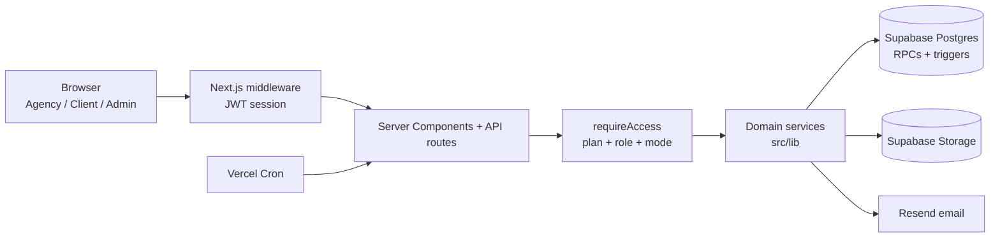

<p align="center">
  <picture>
    <source media="(prefers-color-scheme: dark)" srcset="public/brand/logo-full-light.svg" />
    
  </picture>
</p>

<h1 align="center">OpsVora</h1>

<p align="center">
  <b>The operating system for agencies.</b><br/>
  Clients, projects, deliverables, invoices and e-signed agreements in one workspace,<br/>
  with a client portal in the agency's own brand.
</p>

<p align="center">
  <a href="https://opsvora.com"><b>Website</b></a> ·
  <a href="https://app.opsvora.com"><b>Live app</b></a> ·
  <a href="https://youtu.be/Xeriia4Q564"><b>Demo video</b></a> ·
  <a href="docs/OpsVora-walkthrough.mp4"><b>Walkthrough (MP4)</b></a> ·
  <a href="docs/TECHNICAL_DESIGN.md"><b>Technical design document</b></a>
</p>

---

## What OpsVora is

OpsVora is a multi-tenant operations platform for service businesses: creative agencies, consultancies, studios and in-house teams that deliver work to clients. One workspace covers the whole client lifecycle:

**Onboard the client → plan the work → deliver it for review → get it approved → invoice → get paid → sign the contract**

Each agency gets its own branded client portal, so its clients log in to one place to see progress, approve work, download files, pay invoices and sign agreements.

## The problem we are solving

A typical 10 to 50 person agency runs on five or six disconnected tools: a task board, a shared drive, spreadsheets for invoices, email threads for approvals, a separate e-signature subscription and WhatsApp for everything else. That causes real, measurable pain:

- **Approvals get lost.** Feedback arrives across email, chat and calls, and nobody knows which version the client actually approved.
- **Cash flow suffers.** Invoices go out late, reminders are manual, and payment status lives in someone's spreadsheet.
- **Contracts are slow and risky.** Offer letters and client contracts bounce between Word, PDF and a paid e-sign tool, with no link to the project they belong to.
- **Clients get a fragmented experience.** They juggle links, attachments and logins from different tools, none of which carry the agency's brand.
- **Owners have no single view.** Answering "what's pending, what's approved, what's unpaid?" takes hours.
- **Tool costs stack up** per seat, per tool, every month.

## How it's different

| | Typical tool stack | OpsVora |
|---|---|---|
| Scope | One tool per job (tasks, files, invoices, e-sign) | The whole client lifecycle in one workspace |
| Client experience | Many links and logins, the vendors' branding | One portal in the agency's own brand, themed automatically from its logo |
| Approvals | Scattered across email and chat | Versioned deliverables with a formal approve or request-changes flow and an audit trail |
| E-signature | A separate paid tool | Built in and tamper-evident: SHA-256 document hashing, signer identity check, sealed PDF with a certificate |
| Hiring | Offer letter signed in one tool, onboarding done by hand | Signing an offer letter adds the person to the team automatically |
| Access control | Fixed roles hard-coded per product | Plans, features, permissions and limits editable at runtime by the operator, no deploy needed |
| Money | Spreadsheet maths | Exact integer currency maths, multi-currency, invoices locked by the database once sent |

## Why it matters

- **Faster approvals and payments mean healthier cash flow** for small businesses, one of the most common reasons small service businesses struggle.
- **Trust by design.** Every approval, signature and payment is recorded and verifiable, which reduces disputes with clients.
- **A professional, branded experience** lets a small agency look and operate like a large one.
- **One subscription instead of five or six** lowers cost and removes the work of stitching tools together.
- **Built for scale from day one:** multi-tenant, with server-side permission checks on every request and data isolation per agency.

## How large enterprises such as Jio can benefit

OpsVora was built for agencies, but the same model of plans, roles and branded portals maps directly onto large enterprises. These are opportunities, not existing partnerships:

1. **Managing external agencies and vendors.** Large brands work with dozens of creative, media and digital agencies. OpsVora gives each vendor relationship one place for briefs, versioned deliverables, sign-offs, contracts and invoices, with a clear audit trail for procurement and compliance.
2. **A white-label offering for SMB customers.** A telecom and digital platform company like Jio serves millions of small businesses. OpsVora's multi-tenant design and runtime-editable plans mean it could be bundled as a branded "business operations" product for SMBs, with plan tiers controlled centrally, alongside connectivity and other business services.
3. **Internal shared-services teams.** In-house design, marketing, legal or IT teams effectively run as agencies serving many business units. They can use projects, deliverable approvals and agreements with business units as "clients", with role-based access per team.
4. **Hiring and onboarding at scale.** Offer letters are generated from templates, e-signed, and the candidate joins the right team with the right role automatically, cutting manual HR steps for contract and freelance staff.
5. **Governance and audit.** Plan and permission changes, approvals and signatures are logged, which fits enterprise needs for traceability and controlled access.
6. **Data residency and control.** OpsVora runs on Next.js and PostgreSQL and can be self-hosted with Docker, so an enterprise can deploy it in its own cloud or region.

## Who it's for

- **Agencies and studios** (design, marketing, development, content) of 2 to 200 people
- **Freelancers and consultants** who want a professional client portal
- **Enterprises** managing many agencies and vendors, or running internal teams as service providers
- **Platforms** that want to offer branded business tools to their SMB customers

---

## For the judges

| | |
|---|---|
| **Track** | OpsVora |
| **Website** | https://opsvora.com (start here for the product overview) |
| **Live app** | https://app.opsvora.com |
| **Demo video** | https://youtu.be/Xeriia4Q564 (also downloadable as [docs/OpsVora-walkthrough.mp4](docs/OpsVora-walkthrough.mp4)) |
| **Technical design document** | [docs/TECHNICAL_DESIGN.md](docs/TECHNICAL_DESIGN.md) |

### Demo logins

Log in at **https://app.opsvora.com/login**. One login page serves every portal; you land in the right one automatically.

| Role | Email | Password | What to try |
|---|---|---|---|
| Agency admin | `pandeyayush2111@gmail.com` | `Demo@821303` | Create a project, add tasks on the Kanban board, send a deliverable for review, issue an invoice, send an agreement for signature |
| Client | `ayushpandeywork2111@gmail.com` | `Demo@821303` | Approve or request changes on a deliverable, view an invoice, sign an agreement |
| Team member (Manager) | `ayushroyking@gmail.com` | `Demo@821303` | See the role-based workspace: projects, tasks and deliverables, without billing and workspace settings |

These are demo accounts with sample data. Please don't change their passwords.

### Suggested 5-minute walkthrough

0. Start at **https://opsvora.com** for the product story, features and pricing.
1. Log in as the **agency admin** and open **Clients**, then a client's **Preview** to see their branded portal.
2. Open **Deliverables**, upload a file and **send it for review**.
3. Log in as the **client** in a private window, open the deliverable and **request changes** or **approve** it. The agency gets a notification.
4. Back as the agency, create an **Agreement** from a template and send it to the client.
5. As the client, **sign it** (typed or drawn). Download the sealed PDF with its audit certificate.
6. As the agency, create an **Invoice**, send it and record a payment.

---

## What it does

| Portal | For | Highlights |
|---|---|---|
| **Agency workspace** | Admins, managers, team members | Clients, projects, Kanban tasks, versioned deliverables with client review, documents, invoices with PDF and reminders, agreements and e-signature, team invites, notifications, branding |
| **Client portal** | The agency's clients | Branded with the agency's logo and colours; approve deliverables, download documents, view invoices, sign agreements |
| **Super-admin** | Platform operator | Edit plans, features, role permissions and limits at runtime; per-agency overrides; invites; audit log |

### Highlights

- **Runtime-editable RBAC.** Four roles, 15 features, granular `feature.action` permissions and plan limits. Declared in code, decided in the database, editable by the operator without a deploy.
- **Tamper-evident e-signature.** SHA-256 document hashing verified at signing time, optional emailed one-time code, sealed PDF with a certificate and append-only audit trail. Signing an offer letter adds the candidate to the team in the same transaction.
- **Automatic white-labelling.** The client portal theme is extracted from the agency's logo, with WCAG contrast checks.
- **Correct money.** `BigInt` minor units, per-currency decimals, basis-point tax and discount, and database triggers that lock sent invoices.
- **Defence in depth.** Route guard, then row scope, then database RPC re-checks. The browser never queries the database directly.
- **One login, many workspaces.** The same person can run one agency and be a client of another.

## Architecture



More diagrams (request lifecycle, onboarding, deliverable state machine, e-signature sequence, data model) are in the [technical design document](docs/TECHNICAL_DESIGN.md).

## Tech stack

Next.js 16 (App Router) · React 19 · TypeScript · Supabase (Postgres, Auth, Storage) · Tailwind CSS 4 · Radix UI · Framer Motion · pdf-lib · Resend · Upstash Redis · Vitest · Vercel / Docker

## What's in this repository

The product is live at **https://app.opsvora.com** (demo logins above), so this repository is a curated subset of the codebase for review:

- **Core domain logic** (`src/lib/`): access control and plan entitlements, the feature registry, invoices and money maths, agreements and e-signature, deliverables, documents, notifications, comments, onboarding and rate limiting.
- **The full unit test suite**: 29 test files, 204 tests.
- **The technical design document** and the walkthrough video (`docs/`).

The UI, API routes, database migrations and deployment configuration are kept private.

## Run the tests

```bash
git clone https://github.com/Pandeyayush21/Hackathon_OpsVora.git
cd Hackathon_OpsVora
npm install
npm test
```

No database or environment variables are needed: the tests cover pure domain logic, with Supabase faked where a service is involved (`src/test/fake-supabase.ts`). See [section 7 of the design document](docs/TECHNICAL_DESIGN.md#7-testing) for what each test covers.

## Project structure

```
src/lib/access/         Plan entitlements, access modes, the requireAccess guard
src/lib/registry/       Catalog of features, permissions, roles, limits and portal navigation
src/lib/invoices/       Money maths, invoice rules, PDF rendering, RPC error mapping
src/lib/agreements/     Templates, signing rules, PDF hashing and sealing
src/lib/deliverables/   Review state machine and client view
src/lib/...             Clients, projects, documents, files, notifications, comments, onboarding
src/test/               Test helpers and the schema-guard test
docs/                   Technical design document and walkthrough video
```
