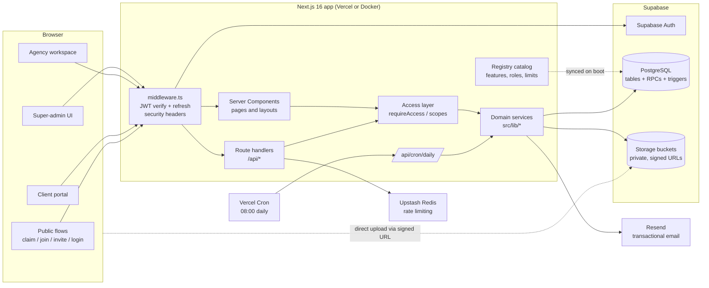
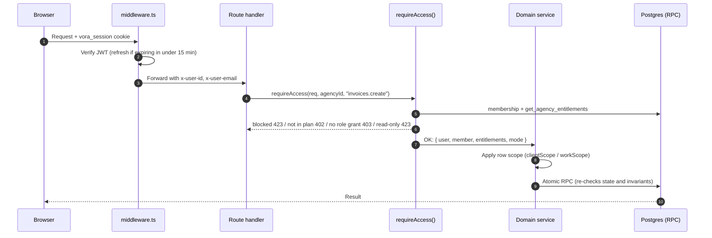
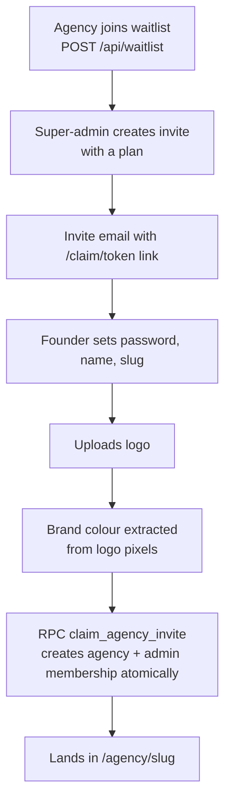
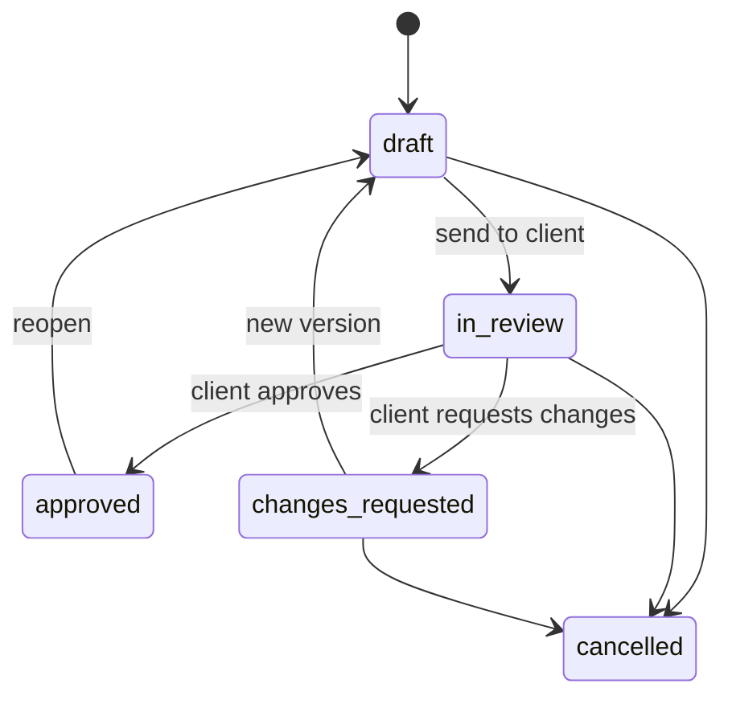
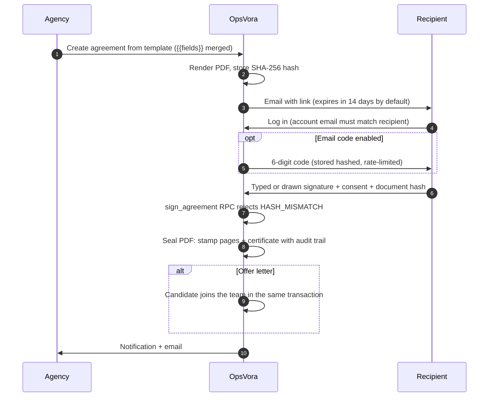
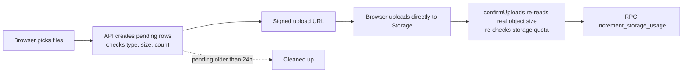
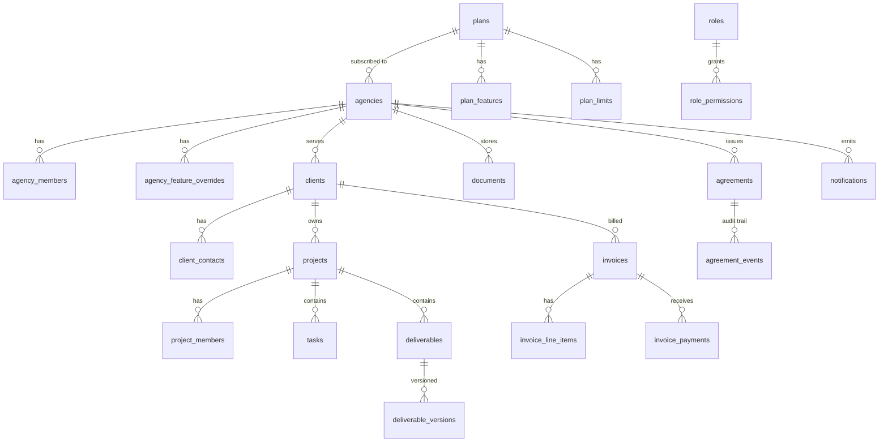

# OpsVora: Technical Design Document

> Track: **OpsVora**
> Website: https://opsvora.com
> Live app: https://app.opsvora.com
> Demo video: https://youtu.be/Xeriia4Q564

## Contents

1. [Project overview](#1-project-overview)
2. [System architecture](#2-system-architecture)
3. [Key flows](#3-key-flows)
4. [Code explanations](#4-code-explanations)
5. [Data model and security](#5-data-model-and-security)
6. [Setup and deployment](#6-setup-and-deployment)
7. [Testing](#7-testing)
8. [Assumptions and known limitations](#8-assumptions-and-known-limitations)

---

## 1. Project overview

### The problem

Small creative and digital agencies run their business across many tools: one for tasks, a shared drive for files, a spreadsheet for invoices, email threads for approvals, and a separate e-signature tool for contracts and offer letters. Clients get a scattered experience and agency owners have no single view of their operations.

### The solution

**OpsVora** is a multi-tenant operations platform where an agency runs its whole client relationship in one place, and the client sees all of it through a portal in the agency's own brand.

| Surface | Who uses it | What it does |
|---|---|---|
| **Super-admin** (`/super-admin`) | Platform operator | Invite agencies, edit plans, features and role permissions at runtime, override entitlements per agency, view the audit log and waitlist |
| **Agency workspace** (`/agency/[slug]`) | Agency admins, managers, team members | Clients, projects, tasks (Kanban), deliverables with review cycles, documents, invoices, agreements and e-signature, team, notifications, branding |
| **Client portal** (`/portal/[slug]`) | The agency's clients | Branded portal to approve deliverables, download documents, pay or view invoices, sign agreements |
| **Public flows** | New users | Agency claim (`/claim/[token]`), team join (`/join/[token]`), client invite (`/client-invite/[token]`), single login, password reset, waitlist API |

### What makes it different

- **Plan-driven RBAC that the operator edits at runtime.** Features, permissions and limits are declared in code but decided in the database. The super-admin can turn a feature on for one plan, grant a permission to a role, or give one agency an extra 5 seats, with no deploy.
- **Built-in, tamper-evident e-signature.** Agreements (client contracts, NDAs, offer letters) are hashed with SHA-256, the signer's browser proves it saw the same bytes, and the final PDF is sealed with a certificate page and an append-only audit trail. Signing an offer letter atomically adds the candidate to the team.
- **Automatic white-labelling.** On onboarding, OpsVora extracts the dominant brand colour from the agency's logo and themes the client portal with a WCAG-contrast-safe palette.
- **Money handled correctly.** Invoice maths uses integer minor units with `BigInt`, per-currency decimals (JPY 0, KWD 3), basis-point tax and discount, and database triggers that lock sent invoices.
- **One login, many workspaces.** A person can be an admin in one agency and a client of another; login routes them to the right place.

---

## 2. System architecture

### High-level architecture



### Request lifecycle

Every request passes through the same layers. Authorization is checked in application code and again by the database.



### Folder structure

```
src/
  middleware.ts          Session verification, refresh, security headers
  instrumentation.ts     Syncs the feature registry to the DB on server boot
  app/
    super-admin/         Platform operator portal
    agency/[slug]/       Agency workspace (admin, manager, team member)
    portal/[slug]/       Branded client portal
    claim/ join/ client-invite/ login/ reset-password/   Public flows
    api/                 Route handlers (one folder per resource)
  lib/
    access/              Entitlement resolution, access modes, guards
    registry/            Code catalog of features, permissions, roles, limits, nav
    auth/ portal/        Session helpers, portal context, client gate
    agency/ clients/ projects/ deliverables/ documents/
    files/ invoices/ agreements/ comments/ notifications/
    onboarding/ email/ supabase/
    rate-limit.ts
  components/            UI by domain, plus shared shell and ui primitives
  test/                  Cross-cutting tests (schema guards)
supabase/migrations/     Ordered SQL migrations (schema, RPCs, triggers, RLS)
scripts/                 create-admin, cleanup-orphans
```

---

## 3. Key flows

### Agency onboarding



### Deliverable review cycle



Any other transition throws `ILLEGAL_TRANSITION` (`src/lib/deliverables/rules.ts`). The client's decision is applied by the atomic RPC `decide_deliverable`.

### E-signature



### Invoice lifecycle

`draft -> sent -> paid` or `void`. The UI also shows the derived states `viewed`, `partly_paid` and `overdue`. Drafts are fully editable. A sent invoice only allows the due date, notes, payment link and internal note to change, and this is enforced by the `invoices_lock_sent` and `invoice_lines_draft_only` database triggers as well as in code.

### File upload



---

## 4. Code explanations

### 4.1 Registry: code declares, database decides

`src/lib/registry/catalog.ts` is the single source of truth for what exists:

- **Roles:** `admin`, `manager`, `creator` (Team Member), `client`.
- **Features:** dashboard, settings, branding, notifications, team, leaves, agreements, clients, client_portal, projects, tasks, deliverables, documents, invoices, comments.
- **Permissions:** keyed `feature.action` (for example `invoices.create`). `view` and `access` are reads; everything else is a write.
- **Limits:** `teamMembers`, `clients`, `projects`, `storageMB`, `agreementsMonthly` (`-1` = unlimited).

On server boot, `src/instrumentation.ts` upserts this catalog into the database (`registry/sync.ts`) without overwriting anything the super-admin has edited. From then on, the database decides which plan gets which feature and which role gets which permission.

### 4.2 Entitlement resolution and access modes

`src/lib/access/resolve.ts` mirrors the SQL RPC `get_agency_entitlements`:

- **Feature enabled?** `coming_soon` or `deprecated` means off. Otherwise: agency override, else plan, else whether it is a core feature.
- **Limit value?** agency override, else plan, else default.

Results are cached for 300 seconds with tags and invalidated when the super-admin edits a plan.

`src/lib/access/modes.ts` turns billing state into an access mode:

| Mode | When | Effect |
|---|---|---|
| `full` | Normal | Everything allowed by plan and role |
| `grace` | Past due for 7 days or less | Full access, with a warning |
| `readonly` | Canceled, or past due for more than 7 days | Writes return `423 READ_ONLY` |
| `blocked` | Suspended by the operator | Everything returns `423 AGENCY_SUSPENDED` |

### 4.3 The guard

```ts
// src/lib/access/guards.ts
requireAccess(request, agencyId, 'invoices.create')
// -> { error } or { user, member, entitlements, mode }
```

Checks run in a fixed order so the user always gets the most useful error: blocked, then feature not in plan (`402`), then role lacks the permission (`403`), then read-only write (`423`). Plan limits are checked separately with `checkLimit`, which returns `402 PLAN_LIMIT`.

### 4.4 Row scoping

Passing the guard is not enough to see data. Every query a client or team member can reach goes through a scope:

- `clientScope()` (`src/lib/clients/scope.ts`): staff see all clients; a client contact sees only the clients they are an active contact for.
- `workScope()` (`src/lib/projects/scope.ts`): admins and managers see all projects; team members see projects they are a member of; clients see their own clients' projects.
- `documentScope()` adds visibility and project filters for documents.

### 4.5 Money

`src/lib/invoices/money.ts` never uses floating point for money:

- Amounts are integer minor units stored as `BigInt`, with a per-currency digit table (JPY and KRW have 0 decimals, BHD, KWD and OMR have 3).
- Quantities are stored in thousandths, tax and discount in basis points.
- Rounding is half away from zero; a discount can never exceed the subtotal.

### 4.6 E-signature integrity

`src/lib/agreements/`:

- `template.ts` merges `{{field}}` placeholders (agency name, date, recipient details, custom fields) and validates that every field is filled.
- `pdf.ts` renders the agreement with `pdf-lib`, computes its SHA-256 hash and, after signing, `sealAgreementPdf` stamps every page and appends a certificate with the full audit trail (IP, device summary, timestamps, consent text).
- `agreement_events` is append-only and the `agreements_lock` trigger prevents edits to sent agreements.

### 4.7 Brand colour extraction

`src/lib/onboarding/brand-color.ts` picks a theme colour from the uploaded logo: it downsamples the image to 48x48, buckets the pixels by colour while skipping transparent and grey pixels, weights saturated colours higher, and falls back to a monochrome theme. `readableOn()` in `src/lib/agency/brand.ts` uses WCAG relative luminance to choose readable text on that colour.

### 4.8 Notifications

`notify()` (`src/lib/notifications/`) de-duplicates recipients, drops the actor, and re-checks each recipient's membership, plan feature, role permission and row scope before delivering, so a notification never reveals something the recipient cannot open. Users choose `instant`, `daily` or `off` per category.

### 4.9 Daily cron

`/api/cron/daily` (protected by `CRON_SECRET`) runs isolated steps in order: invoice reminders, due-soon task notifications, agreement expiry and reminders, retrying any unsealed signed PDFs, daily email digests, and pruning old notifications. One failing step does not stop the others.

### 4.10 Rate limiting

`src/lib/rate-limit.ts` uses an Upstash Redis sliding window when configured, with an in-memory fallback for local development. Examples: login 5/min, waitlist 3/min, password reset 3 per 5 min, uploads 60/hour, signing 10/hour, signing code 3 per 10 min.

---

## 5. Data model and security

### Core entities



`agency_members (agency_id, user_id, role, status)` is the single source of truth for who belongs where, which is what lets one person belong to several agencies.

### Security model

- **Sessions:** short-lived access JWT (`vora_session`, 1 hour) and refresh token (`vora_refresh`, 7 days), both `httpOnly`, `secure` in production and `SameSite=Lax`. Tokens never reach JavaScript.
- **Database access is server-only.** The browser never queries tables. Migrations 040 and 041 enable RLS with no policies on new tables and revoke `EXECUTE` on all functions from `anon` and `authenticated`, so even a leaked anon key cannot read or call anything.
- **Defence in depth:** the route guard checks permission, the service applies row scope, and the RPC or trigger re-checks state (for example, an invoice that is already paid cannot be paid again).
- **Storage:** all buckets except logos are private and served via short-lived signed URLs. Executable and script file types (including SVG and HTML) are blocked; file names are sanitised.
- **Headers:** CSP, `X-Frame-Options: DENY`, `nosniff` and a restrictive `Permissions-Policy` on every page.
- **Safe redirects:** `safeNext()` prevents open redirects after login.
- **Enumeration resistance:** login returns the same error for an unknown email or a wrong password.

---

## 6. Setup and deployment

> **Note for reviewers:** the product is live at https://app.opsvora.com. This public repository contains a curated subset (the core domain logic in `src/lib`, the full unit test suite and this document). To run the tests, `npm install` then `npm test`; no database or environment variables are needed. The steps below describe how the full application, including the private UI, API routes and migrations, is set up and deployed.

### Prerequisites

- Node.js 20+
- A Supabase project (free tier works)
- A Resend account for email (the `onboarding@resend.dev` sender works for testing)
- Optional: Upstash Redis for production rate limiting

### Local setup

```bash
git clone https://github.com/Pandeyayush21/Hackathon_OpsVora.git
cd Hackathon_OpsVora
npm install
cp .env.example .env.local      # then fill in the values
```

1. **Database.** In the Supabase SQL editor, run every file in `supabase/migrations/` in numeric order (001 to 048), as the `postgres` role. Migration 039 is intentionally absent; 044 covers it.
2. **First super-admin.**
   ```bash
   npm run create-admin -- you@example.com
   ```
   You will be prompted for a password.
3. **Run.**
   ```bash
   npm run dev
   ```
   Open http://localhost:3000/super-admin/login. The feature registry syncs to the database automatically on boot (or click **Sync registry** on the Features page).
4. **Create an agency.** In the super-admin portal, go to Invites, create an invite, open the `/claim/...` link and complete onboarding. From the agency workspace you can then invite clients and team members.

### Environment variables

| Variable | Required | Purpose |
|---|---|---|
| `NEXT_PUBLIC_SUPABASE_URL` | Yes | Supabase project URL |
| `NEXT_PUBLIC_SUPABASE_ANON_KEY` | Yes | Used only for password sign-in |
| `SUPABASE_SERVICE_ROLE_KEY` | Yes | Server-side database access |
| `RESEND_API_KEY`, `RESEND_FROM_EMAIL` | Yes | Transactional email |
| `NEXT_PUBLIC_APP_URL` | Yes | Absolute links in emails |
| `CRON_SECRET` | For cron | Bearer token for `/api/cron/daily` |
| `RESEND_CLIENT_API_KEY` | No | Separate key for agency-to-client mail |
| `WEBSITE_ORIGIN` | No | Allowed CORS origins for `/api/waitlist` |
| `UPSTASH_REDIS_REST_URL`, `UPSTASH_REDIS_REST_TOKEN` | No | Distributed rate limiting |
| `REGISTRY_AUTOSYNC` | No | Set `false` to skip registry sync on boot |

### Deploying to Vercel

1. Import the repository into Vercel (framework preset: Next.js).
2. Add the environment variables above.
3. Deploy. `vercel.json` registers the daily cron job at 08:00 UTC; Vercel sends `CRON_SECRET` automatically.

### Deploying with Docker

```bash
docker build \
  --build-arg NEXT_PUBLIC_SUPABASE_URL=... \
  --build-arg NEXT_PUBLIC_SUPABASE_ANON_KEY=... \
  --build-arg NEXT_PUBLIC_APP_URL=... \
  -t opsvora .
docker run -p 3000:3000 --env-file .env.local opsvora
```

The image uses Next.js standalone output. Public values are baked in at build time; secrets are supplied at runtime.

---

## 7. Testing

```bash
npm test
```

**29 test files, 204 tests, all passing** (Vitest, Node environment). The tests focus on the logic that would be costly to get wrong:

| Area | Files | What is covered |
|---|---|---|
| Access control | `access/guards`, `access/modes`, `access/resolve`, `registry/catalog`, `registry/portal-nav` | Deny codes and their order, grace and read-only modes, feature and limit resolution, catalog integrity, nav visibility |
| Auth | `auth/home` | Open-redirect safety, choosing the right home portal |
| Invoices | `invoices/money`, `invoices/rules`, `invoices/pdf`, `invoices/service`, `invoices/map-rpc-error` | Minor-unit maths, zero-decimal currencies, editable fields after sending, PDF text encoding, cross-agency protection |
| Agreements | `agreements/rules`, `agreements/template`, `agreements/pdf` | Status transitions, recipient matching, expiry, template merging, hashing and sealing |
| Deliverables | `deliverables/rules`, `deliverables/client-view` | State machine, submit and decide permissions, client-facing shape |
| Data scoping | `clients/clients`, `documents/access`, `documents/service`, `projects/projects`, `portal/client-gate` | Client and work scopes, document visibility, sign-first portal gate |
| Platform | `files/engine`, `notifications/*`, `comments/format`, `onboarding/slug`, `agency/team`, `rate-limit` | Upload cleanup, notification audience, mentions, reserved slugs, last-admin protection, limiter |
| Schema guards | `src/test/schema-guards.test.ts` | Statically scans all source files for queries on columns that do not exist, catching bugs Supabase would otherwise return as silently swallowed errors |

---

## 8. Assumptions and known limitations

**Assumptions**

- An agency is the tenant. Every row belongs to exactly one agency, and every query is filtered by it.
- Agencies are onboarded by invite (from the waitlist) for now; self-serve sign-up with payment is planned.
- Clients and candidates sign with an OpsVora account whose email matches the recipient address. This trades a little friction for a stronger identity check than a bare email link.
- Typed and drawn signatures with a hashed audit trail are sufficient for the target market (agency contracts, NDAs, offer letters). This is a simple electronic signature, not a qualified one.
- Email delivery is via Resend; the app works without email in development, but invites and resets need it.

**Known limitations**

- **Leaves** and **Billing** (plan payments) are on the roadmap; Leaves is visible as "coming soon" in the navigation.
- Plan state such as `past_due` is set manually by the operator until payments are integrated.
- Unit tests cover the domain logic; there are no end-to-end browser tests yet.
- Migrations are applied manually in the Supabase SQL editor rather than through the Supabase CLI.
